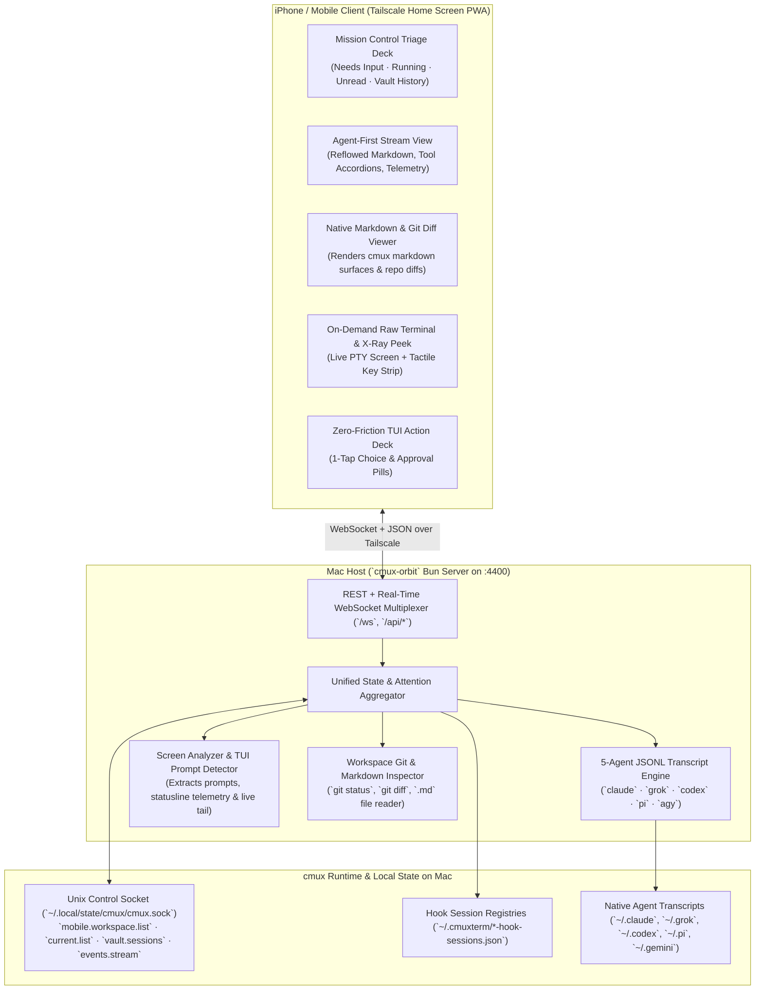

# ✦ `cmux-orbit`

**Agent-First Mobile Mission Control for [`cmux`](https://github.com/manaflow-ai/cmux)** — Run and orchestrate **Claude Code (`claude`), Grok CLI (`grok`), OpenAI Codex (`codex`), Pi (`pi`), Antigravity (`agy`), and raw shells** natively from your iPhone over Tailscale.

---

## Why `cmux-orbit` Exists

When running 5–10+ parallel workspaces and 20+ surfaces in `cmux` on macOS, stepping away from your desk breaks the multi-agent supervision loop:
1. **Why Terminal Mirroring Apps Fail AI Coding Agents:** Existing remote terminal apps (and `NewTurn2017/cmux-remote`) treat AI coding agents like 1980s `vim`. Rendering a 120-column ASCII grid at `8pt` font inside a 2D scroll view with CRT scanline shaders and a permanent 172pt 13-button keyboard deck makes reading 1,500-word syntheses, diffs, or `.md` plans painful. Worse, resizing a desktop PTY (`SIGWINCH`) to mobile portrait width (`66 cols`) corrupts Ink/TUI box rendering on your Mac.
2. **Why Pure Single-Provider Chat Wrappers Fail `cmux` Power Users:** `cmux` power users don't just run one CLI agent—they run **Claude Code, Grok CLI, Codex, Pi, and Antigravity side-by-side** alongside native `cmux markdown` viewer panels (`BUILD-PLAN.md`, `ACCESS-LAYERS.md`) and raw shells.

### Core Design Philosophy: **Agent-First by Default, Raw CLI on Demand**

| Dimension | `cmux-remote` / Traditional SSH | ✦ `cmux-orbit` |
| :--- | :--- | :--- |
| **Default Surface View** | `8pt` 120-column ASCII grid requiring 2D horizontal/vertical panning + CRT scanlines | **Mobile-Reflowed `15px` Agent Conversation Stream** with collapsible tool call accordions & reasoning blocks |
| **Supported Agent Transcripts** | None (raw terminal text only) | **5-Agent Native JSONL Engine**: Claude Code (`claude`), Grok CLI (`grok`), OpenAI Codex (`codex`), Pi (`pi`), and Antigravity (`agy`) + live terminal tail |
| **Interactive TUI Prompts** | Manually hunt for tiny `↑`/`↓`/`Enter` keys on a 13-button bar | **Deterministic TUI Action Deck**: Auto-detects numbered choices (`1. Yes`, `2. Always`, `3. No`), `(y/n)` prompts, and `esc to interrupt` and renders `44px+` 1-tap thumb pills above the composer |
| **Multi-Workspace Triage** | Static index list (`01`, `02`...) with permanent rename/delete buttons | **Mission Control Triage Deck**: Priority-sorted `NEEDS INPUT` & `RUNNING` attention cards with **1-tap inline approval** and direct surface jump pills |
| **Claude Statusline & Subagents** | Buried in raw bottom rows | **Native Telemetry Chips**: Extracts model (`Opus 5.5`), context `%`, session/daily cost, permission mode, and active subagent waves (`◯ REG`, `◯ L137`) |
| **Markdown & Git Diffs** | Unreadable in 80-column terminal | **Native `📄 Doc` & `± Diff` Modes**: Renders `cmux markdown` surfaces and syntax-highlighted unified `git diff` cards |
| **Raw CLI / Shell Access** | Forced as the cramped default everywhere | **1-Tap `>_ CLI` Mode + Hold-to-Peek X-Ray**: Drop down to the raw terminal, toggle `$ Cmd` mode (`! <cmd>`), or open the `⌘` tactile key strip on demand |
| **iOS Installation** | App Store / 7-day Xcode sideload expiry | **Zero-Expiry Tailscale Home Screen PWA** (`Share → Add to Home Screen`) + `launchd` background daemon |

---

## System Architecture



---

## Quick Start

### Prerequisites
- macOS running [`cmux`](https://cmux.com) with Socket Control enabled (`"automation": { "socketControlMode": "allowAll" }` in `~/.config/cmux/cmux.json`)
- [Bun](https://bun.sh) (`brew install oven-sh/bun/bun`)
- [Tailscale](https://tailscale.com) installed on your Mac and iPhone

### 1. Install & Run as a Persistent Background Service (`launchd`)

```bash
git clone https://github.com/FelixIsaac/cmux-orbit.git
cd cmux-orbit

# Install and start the persistent macOS LaunchAgent on port 4400
./bin/cmux-orbit install-service

# Check live status and your Tailscale iPhone URL
./bin/cmux-orbit status
```

### 2. Add to iPhone Home Screen
1. On your iPhone (connected to Tailscale), open Safari and navigate to your Mac's Tailscale URL printed by `./bin/cmux-orbit status` (e.g., `http://100.64.0.26:4400`).
2. Tap **Share (`↑`) → Add to Home Screen → Add**.
3. Launch **cmux Orbit** from your Home Screen as a full-screen standalone app.

---

## CLI Reference

```bash
# Run server in foreground (default port 4400)
./bin/cmux-orbit start --port 4400

# Inspect connection to cmux.sock, workspace/surface counts, and Tailscale IP
./bin/cmux-orbit status

# Install & start auto-restarting macOS launchd service (~/.local/state/cmux-orbit/)
./bin/cmux-orbit install-service

# Uninstall launchd service
./bin/cmux-orbit uninstall-service

# Run unit & live cmux.sock integration tests
bun test
```

---

## Native Swift Companion (macOS & iOS)

In addition to the zero-expiry PWA, `cmux-orbit` includes a pure Swift native companion package in `native/` with **zero third-party dependencies**, leveraging Apple frameworks (`SwiftUI`, `AppKit`, `Network.framework`, `UserNotifications`, `ActivityKit`, and `WidgetKit`).

### macOS Features (`CmuxOrbitMac`)
- **Native Menu Bar Extra (`MenuBarExtra`)**: Resides in your menu bar with a live indicator showing running agents, unread turns, and attention counters.
- **Spotlight-Style Floating HUD Overlay (`⌘⇧O` / `Cmd+Shift+O`)**: High-performance translucent glass HUD panel centered over full-screen IDEs and terminals. Search workspaces, jump to agents, approve interactive tool calls (`[1] Approve`, `[2] Always`, `[Esc] Deny`), and dispatch prompts instantly without switching focus.
- **Interactive Action Notifications (`UNNotificationCategory`)**: System banners for permission requests with inline action buttons (`Approve (1)`, `Always Allow (2)`, `Deny (Esc)`, and `Reply with Prompt...`).
- **Dynamic Dock Badge (`NSApp.dockTile.badgeLabel`)**: Displays real-time badge count for turns requiring human attention.
- **Direct Unix Domain Socket IPC (`NWConnection`)**: Directly connects to `~/.local/state/cmux/cmux.sock` via Unix domain socket for sub-millisecond JSON-RPC dispatch without HTTP overhead.

### iOS Features (`CmuxOrbitIOS`)
- **Dynamic Island & Lock Screen Live Activities (`ActivityKit`)**: Real-time tracking of active agent turns, running tool executions, elapsed time, and token cost right on the Lock Screen and Dynamic Island.
- **Lock Screen & Home Screen Widgets (`WidgetKit`)**: Circular gauge for pending approvals, inline status indicator, and medium dashboard widget with live triage status.
- **Tactile Apple Haptics (`Haptics`)**: High-precision physical feedback on approvals, mode transitions, and completions.

### Building & Running Native Apps

```bash
cd native

# Build and run the macOS Menu Bar & HUD app
swift run cmux-orbit-mac

# Or open and build the Xcode project for macOS or iOS Simulator / Device:
xcodegen generate
open CmuxOrbit.xcodeproj
```

---

## Security & Privacy
- **100% Loopback-Bound & Tailnet-Scoped:** `cmux-orbit` binds strictly to `127.0.0.1:4400` (loopback only) and is completely unexposed on untrusted LAN or public Wi-Fi. Remote iPhone access is securely proxied through Tailscale (`tailscale serve` -> `127.0.0.1:4400`) or trusted mesh peer validation (`100.64.0.0/10`, `fd7a:115c:a1e0::/48`). IPv6 link-local (`fe80`) trust is completely disabled to prevent rogue local network access.
- **Zero Telemetry / Zero Cloud Relay:** All conversation transcripts, diffs, and terminal streams travel directly between your Mac and your phone over Tailscale WireGuard encryption.
- **Hardened Host Environment:** Host SSH access is strictly key-only (`PasswordAuthentication no`). Upstream third-party listeners (such as `cmux-relay` on port 4399) are locked down to loopback (`127.0.0.1:4399`) and accessible only via Tailscale serve proxying.

## License
MIT © Felix Isaac Lim
