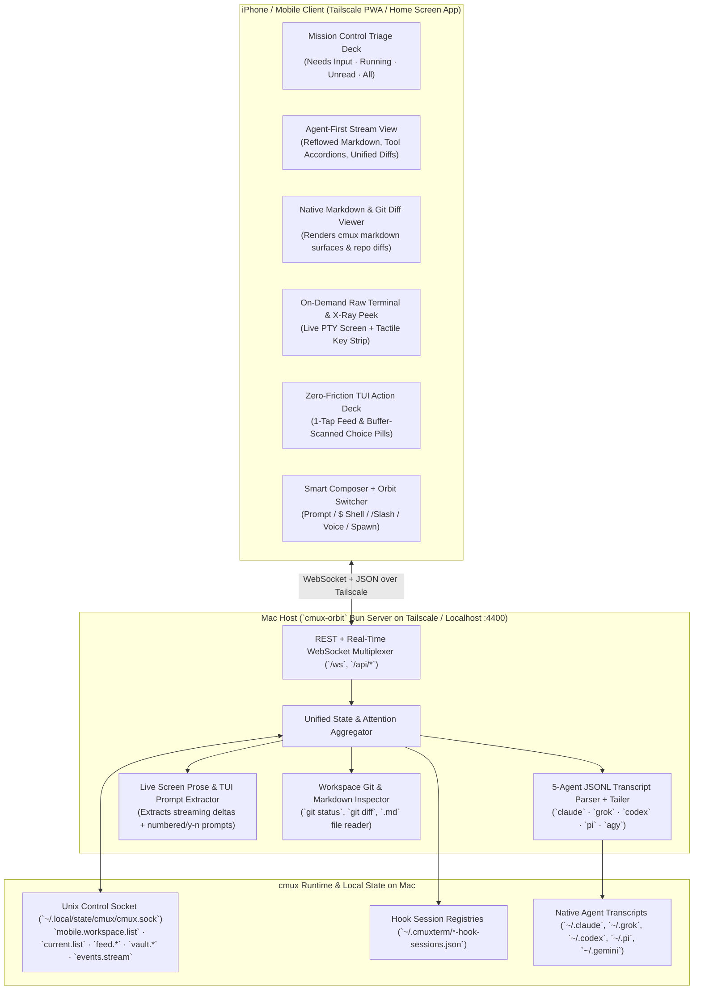

# `cmux-orbit` — Architecture, Prior Art, and UI/UX Specification

## 1. Executive Summary & Design Thesis

`cmux` is a native macOS terminal multiplexer built for orchestrating parallel AI coding agents (`claude`, `grok`, `codex`, `pi`, `agy`, `opencode`). However, stepping away from the Mac breaks the multi-agent supervision loop:
- **Official `cmux` iOS App:** Locked behind a paid Founder's Edition private beta, and its `AgentChatSessionRegistry` currently only resolves structured chat transcripts for `claude` and `codex` (issues `#14479`, `#15663`), leaving `grok`, `pi`, and `agy` unsupported in structured chat mode.
- **Third-Party `NewTurn2017/cmux-remote`:** Treats `cmux` like a 1980s VT100 terminal. It renders a 120-column ASCII grid at `8pt` font inside nested 2D scroll views, applies a CRT scanline Metal shader (`.cmuxScanlines(lineHeight: 2.5, intensity: 0.18, shift: 0.4)`), and permanently consumes `300pt+` of vertical screen height with a 13-button terminal key deck (`esc`, `^C`, `tab`, arrows) and dual redundant back buttons (`<` and `×`).
- **Why Terminal Mirroring Alone Fails Agent Workflows:** Reading 1,500-word agent syntheses, unified git diffs, or architecture `.md` files in an `8pt` 80–120 column grid requires constant horizontal pinching/panning; resizing the PTY (`SIGWINCH`) to phone width (`66 cols`) corrupts Ink/TUI box rendering on the desktop; and answering numbered TUI permission prompts requires hunting for microscopic virtual keys.

> **Core Product Thesis of `cmux-orbit`:**
> **Agent-First by Default, Raw CLI on Demand.**
> Every surface defaults to a clean, mobile-reflowed **Structured Agent Stream** (conversational turns, collapsible tool-call accordions, unified mobile diffs, native markdown viewer, and auto-detected 1-tap TUI approval/choice pills), while preserving 1-tap **X-Ray Terminal Peek & Live CLI Mode** whenever you need raw shell intervention (`! launchctl ...`, `Ctrl-C`, `git status`, `htop`, or arbitrary TUI keys).

---

## 2. Prior-Art Synthesis Matrix

| System | Key Strength Borrowed into `cmux-orbit` | Fatal Flaw Avoided in `cmux-orbit` |
| :--- | :--- | :--- |
| **`manaflow-ai/cmux` (`CmuxAgentChat` + `AgentFeed`)** | **Terminal-as-Source-of-Truth + JSONL Tailing + Spinner-Anchored Screen Prose Extractor** (`AgentChatProseScreenExtractor`): never kills the desktop PTY; tails `.jsonl` for committed turns and extracts live streaming prose above `✻ Forming…` from the terminal buffer. | Locked to paid beta; `AgentChatSessionRegistry` only supports `claude` and `codex` (ignores `grok`, `pi`, `agy`). |
| **`siteboon/claudecodeui` (*CloudCLI*)** | **Regex Terminal Buffer Prompt Scanner (`checkBufferForPrompt`)**: scans the bottom 20 lines of any PTY for numbered TUI options (`❯ 1. Yes`) and projects them into floating 1-tap touch pills above the keyboard. | Web-only SDK spawner; cannot attach to existing live desktop `cmux` terminal panes without restarting the session. |
| **`slopus/happy`** | **Inline Multi-Question Wizard & Permission Rule Synthesis**: clean mobile cards for `AskUserQuestion` and `PermissionRequest` (`Allow Once`, `Allow Always`). | Kills and respawns the local CLI process on every desktop↔phone handoff (`claudeLocalLauncher` ↔ `claudeRemoteLauncher`). |
| **`NewTurn2017/cmux-remote`** | **Zero-Config Tailscale Whois Auth + `cmux.sock` Event Stream + Focus-Gated Key Dispatch** (`surface.focus` before `surface.send_key`). | `8pt` 120-column ASCII grid as default view, CRT scanline shader, 172pt permanent 13-button bottom bar, zero structured agent/JSONL/Feed awareness. |

---

## 3. System Architecture

### Multi-Layer Data Fusion
1. **`cmux.sock` Control RPCs & `events.stream`**:
   - Subscribes to `events.stream` (`categories: ["workspace", "surface", "notification", "system", "agent", "hook"]`) for instant reactive push.
   - Calls `mobile.workspace.list`, `current.list`, `feed.list`, `notification.list`, and `vault.sessions`.
2. **`~/.cmuxterm/*-hook-sessions.json` Direct Reader**:
   - Reads `claude-hook-sessions.json`, `grok-hook-sessions.json`, `codex-hook-sessions.json`, and `pi-hook-sessions.json` to map every `surfaceId` to its exact `sessionId`, `transcriptPath`, `agentLifecycle` (`running` | `idle` | `needsInput`), and `lastBody`.
3. **5-Agent Universal JSONL Transcript Parser (`TranscriptEngine`)**:
   - Resolves and tails the native `.jsonl` transcript file for any surface across **Claude Code**, **Grok CLI**, **OpenAI Codex**, **Pi Agent**, and **Antigravity (`agy`)**.
4. **Live Terminal Screen Prose, Statusline Telemetry & TUI Prompt Extractor (`ScreenAnalyzer`)**:
   - Extracts live streaming agent output above spinner/status lines (`✻`, `◯`), parses Claude Code telemetry (`Opus 5.5`, `ctx: 37.5%`, `cost: $48.70`, `SID`, subagent waves), and detects interactive TUI prompts (`❯ 1. Yes`, `(y/n)`, `esc to interrupt`).
5. **Native Markdown & Git Diff Engine (`WorkspaceInspector`)**:
   - Renders `cmux` `kind: "markdown"` surfaces natively and runs `git status --porcelain -b` / `git diff` on demand for any workspace or surface directory.
